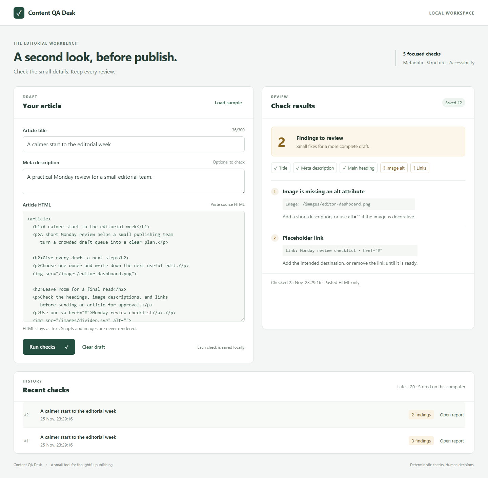

# Content QA Desk

A small editorial tool by Andrii Tynskyi for reviewing pasted article HTML. Run deterministic checks, make an edit, and compare saved draft snapshots. Inspired by everyday CMS and editorial QA work.



[Mobile screenshot](docs/mobile.png)

## Run locally

Requires **Node.js 24.14+ (24.x)** with npm. No API keys, database server, or accounts.

```sh
git clone https://github.com/ta56419/content-qa-desk.git
cd content-qa-desk
npm ci
npm run dev
```

Open **http://127.0.0.1:5173**. One command starts Vite and the API on port 3001, with TypeScript watchers. Both ports must be free. Stop with Ctrl+C. After installation, the app works without internet access.

SQLite is created automatically at `data/reports.sqlite`. Run commands from the project root. Reports survive browser refreshes and server restarts; unfinished edits are not autosaved. `DB_PATH` can override the database location. Local data, dependencies, build output, and secrets are ignored by Git.

## Try the sample

1. The original sample is loaded on first visit; **Load sample** restores it.
2. Select **Run checks**: expect **3 findings** (missing meta description, missing image alt attribute, placeholder link).
3. Add a meta description and run again: expect **2 findings**, saved as a new report.
4. Refresh, then select the latest item under **Recent checks**. The saved draft and its findings reopen together. Earlier reports keep the original content.
5. Add `alt="An editorial dashboard with drafts awaiting review"` to the first image and replace `href="#"` with `/checklist`. Run again: expect **0 findings**. This does not verify that `/checklist` exists.

The decorative image already uses `alt=""` and is valid for this check. All main actions are standard keyboard-accessible buttons; Enter submits the focused Run checks button.

## Five QA rules

| Rule              | What it flags                                          |
| ----------------- | ------------------------------------------------------ |
| Title             | Empty or whitespace-only title field                   |
| Meta description  | Empty or whitespace-only description field             |
| Main heading      | Zero or multiple H1 elements in the pasted HTML        |
| Image alt         | Images with no `alt` attribute; `alt=""` is valid      |
| Placeholder links | Missing `href`, empty/whitespace `href`, or `href="#"` |

Missing and multiple H1 cases are branches of one rule. Some CMS templates provide the H1 separately; both findings explain this caveat. Named fragments such as `#section` are accepted. Findings show heading text, image source, or link text when available and suggest a concrete fix.

## Stack and design

- **React + TypeScript:** one responsive screen, controlled editor fields, pending/error states, stale-report notice, and recent report loading.
- **NestJS / Node.js:** three REST endpoints, runtime input validation, and a pure rule function.
- **Cheerio (HTML parser):** tolerates malformed HTML and decodes attributes without executing scripts or fetching URLs.
- **SQLite via Node's built-in `node:sqlite`:** one table and parameterized SQL, without an ORM or a separate database process.
- **Vite:** frontend development and production bundle. The development proxy forwards `/api` to NestJS.

Request flow: React sends a draft → controller validates types/lengths → service calls the pure checker → SQLite stores the draft and findings → React displays the returned report.

| Endpoint               | Purpose                                                            |
| ---------------------- | ------------------------------------------------------------------ |
| `POST /api/reports`    | Accept `{title, metaDescription, html}`; check and save a snapshot |
| `GET /api/reports`     | Latest 20 summaries, newest first                                  |
| `GET /api/reports/:id` | Original draft and findings for one saved report                   |

The `reports` table holds `id`, `title`, `meta_description`, `html`, `created_at`, `findings_json`, and `finding_count`. JSON is suitable for the small nested findings list; SQL handles insertion, lookup, and ordering. Snapshots are immutable. All reports remain in the database, even when older than the latest 20 shown in the UI.

Code entry points: `client/App.tsx`, `server/app.ts`, `server/checks.ts`, and `server/reports.service.ts`. Shared types and original sample/fixture content live in `shared/`.

## Verification and metrics

Measured locally on **25 November 2026**. These are reproducible project checks, not production accuracy or user-impact claims.

| Check                          | Observed result                                            |
| ------------------------------ | ---------------------------------------------------------- |
| Implemented rules              | **5**                                                      |
| TypeScript + production build  | Passed                                                     |
| ESLint                         | Passed                                                     |
| Unit tests                     | **14/14 passed** (9 fixture cases + 5 focused edge cases)  |
| API/database integration tests | **5/5 passed**, including persistence after API restart    |
| Browser E2E tests              | **3/3 passed** in Chromium                                 |
| Total automated tests          | **22/22 passed**                                           |
| Labelled fixture drafts        | **9**, including 2 clean drafts                            |
| Expected findings caught       | **15/15**; **0 missed**, **0 false positives**             |
| Fixture recall                 | **100% = 15 ÷ 15 × 100**, only on this small synthetic set |

Expected `(rule, context)` pairs were written by hand in [`shared/fixtures.ts`](shared/fixtures.ts) **before running the checker**. The set covers clean content, decorative empty alt attributes, missing metadata, missing/multiple H1s, absent image sources, four placeholder link variants, HTML entities, malformed markup, and the built-in sample. The metrics script matches a multiset of actual findings against these labels and reports raw counts. The fixtures are intentionally small and are not a representative benchmark of arbitrary websites.

**Browser checks:** automated workflows at **1440×1000** and **390×844** ran the sample, corrected a finding, reran using the keyboard, refreshed, and reopened the saved report. Both checked horizontal overflow and captured the screenshots above. A third test verified escaped hostile snippets, no injected image/script nodes, API failure feedback, and retry.

**Separate manual review:** the live Chrome app was used to run the sample (3 findings), add a description (2 findings), refresh, and reopen the corrected SQLite report. Desktop and mobile screenshots were visually inspected for readable content, wrapping, and layout. This was not a full accessibility audit or a cross-browser test.

**Optional local timing:** median **4.24 ms** across **30 sequential local POST requests**, after 5 excluded warmups; **570 bytes of HTML**, **671-byte JSON body**. Each request included parsing, a file-backed SQLite insert, response transfer over loopback, and JSON decoding. Environment: Windows x64, Node.js **24.22.3**, Intel Core **i5-12450H**. The median is the average of the 15th and 16th sorted timings. Results vary by machine and disk state; this is not a production latency target. No baseline was measured, so no speed or quality improvement is claimed.

Reproduce from the project root (stop `npm run dev` before E2E tests):

```sh
npm ci
npm run build
npm run lint
npm test
npx playwright install chromium
npm run test:e2e
npm run metrics
```

Tests use temporary or in-memory databases, not your saved reports. Browser tests launch their own servers; the application itself needs no browser download. `npm run metrics` checks the committed fixtures and repeats the local timing measurement.

## Limitations and safety

- Pasted HTML only: no WordPress connection, remote link checks, AI rewriting, accounts, or cloud deployment.
- HTML is untrusted. It stays in a textarea; React escapes findings. The app does not render a preview, execute submitted scripts, or load submitted images/links. This is a QA checker, **not an HTML sanitizer**.
- Attribute presence is not a judgment of alt-text quality. Title/meta length, SEO quality, grammar, destination safety, and full accessibility are not checked.
- Validation limits: title 300 characters, description 1,000, HTML 100,000; JSON request limit 512 KB. Empty strings remain valid input so missing content can produce findings.
- SQLite and parsing are synchronous and suited to this small local application. No multi-user scaling, retention UI, or migration system is included.
- Servers bind to loopback. There is no authentication; this version is not intended for public hosting. `npm run build` creates the client bundle and compiled API, but does not deploy them.

## CV evidence

Built a React/TypeScript, NestJS and SQLite content QA tool with 5 deterministic rules and 22 passing automated tests; detected 15/15 labelled findings with zero false positives across 9 synthetic HTML drafts. [Verification and metrics](https://github.com/ta56419/content-qa-desk#verification-and-metrics).

## Technical references

- [NestJS fundamentals](https://docs.nestjs.com/first-steps)
- [Node.js 24 SQLite API](https://nodejs.org/download/release/latest-v24.x/docs/api/sqlite.html)
- [Cheerio documentation](https://cheerio.js.org/docs/intro)
